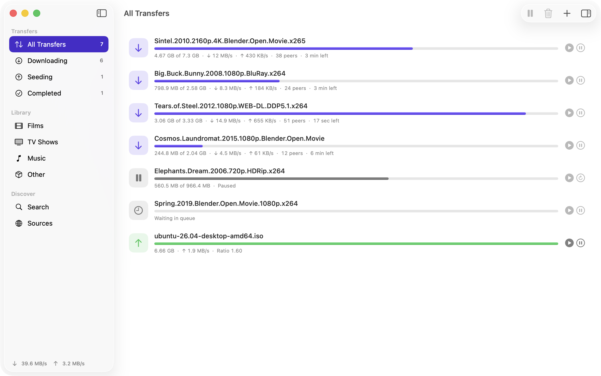

# kTorrent

A native macOS torrent client written in Swift and SwiftUI, with built-in search, play-while-downloading, subtitle matching, AirPlay and an iTunes-style media library.



Requires macOS 14 or later. Universal (Apple Silicon and Intel).

## Download

Get the latest `kTorrent-<version>.zip` from the [Releases page](https://github.com/kylebolton/kTorrent/releases/latest), unzip it and drag kTorrent to Applications. The app is signed with a Developer ID and notarized by Apple, so it opens normally, and it updates itself afterwards (Settings → General → Updates).

## Features

- **Transfers** — magnet links, `.torrent` files and URLs; drag and drop; per-file selection; queueing, speed limits, DHT, PEX, local peer discovery, UPnP/NAT-PMP, encryption; piece map, speed graph, peers and trackers in the inspector.
- **Play before it's finished** — press play on any video or audio file and kTorrent downloads the pieces the player needs first, following the playhead when you seek.
- **Any format** — MP4/MOV play directly; MKV, AVI, WebM and the rest are converted on the fly by a bundled ffmpeg (stream copy where possible, hardware encode otherwise).
- **AirPlay** — send any file to an Apple TV or AirPlay speaker, including while it downloads. Subtitles travel with the stream.
- **Subtitles** — automatically matches subtitle files in the download and tracks embedded in the video, and searches OpenSubtitles by file hash and title. Timing offset, language preferences, drag-in subtitle files.
- **Library** — finished downloads are sorted into Films, TV Shows (by season), Music (songs, albums, artists) and Other, with artwork and details from TMDB or Apple's catalogue. Sortable columns, filters, watched state and resume.
- **Search indexers** — kTorrent runs [Jackett](https://github.com/Jackett/Jackett) privately in the background, so hundreds of public sites are searchable with no setup. The first launch downloads the pinned Jackett release (checked against its SHA-256); it listens on localhost only and quits with the app. Sources → Search indexers → Choose… switches individual sites on or off; only Internet Archive and Linux Tracker are on by default.
- **Search** — one search across all your sources. Ships with Internet Archive and Linux Tracker. Add your own site by typing its address: kTorrent probes for a Torznab API (Jackett/Prowlarr), RSS feed, OpenSearch description or search form, tests it, and learns how to read the results.

## Building

Needs Xcode 16 or later, [XcodeGen](https://github.com/yonaskolb/XcodeGen) and CMake (`brew install xcodegen cmake`).

```sh
scripts/build-deps.sh     # OpenSSL, Boost headers and libtorrent → Vendor/ (about 10 minutes, once)
scripts/build-ffmpeg.sh   # LGPL ffmpeg and ffprobe → Vendor/ (about 5 minutes, once)
scripts/build.sh          # debug build → build/Build/Products/Debug/kTorrent.app
scripts/build.sh test     # unit and integration tests
scripts/release.sh        # universal release build → dist/kTorrent.app and dist/kTorrent.zip
```

`xcodegen generate` creates `kTorrent.xcodeproj` if you'd rather work in Xcode.

Releases are signed with a Developer ID and notarized by `scripts/release.sh`: set `DEVELOPER_ID` to your identity and either `NOTARY_PROFILE` (a `notarytool` keychain profile) or an App Store Connect API key in `~/.appstoreconnect/publish.env`. Without them it makes an ad-hoc signed build that only runs on your own Mac.

## Third-party software

Jackett is GPL-2.0 licensed. kTorrent doesn't modify or link it: it downloads the unmodified release from github.com/Jackett/Jackett and runs it as a separate process. libtorrent (BSD) and an LGPL ffmpeg build are bundled; Sparkle (MIT) handles updates.

## Screenshots and demo mode

Launching with `KTORRENT_DEMO=1` shows a set of fake in-progress transfers (open-licensed films) in a throwaway data folder, which is how `docs/screenshot.png` was made.

## Auto-update

Updates use [Sparkle](https://sparkle-project.org) and an EdDSA-signed `appcast.xml` in this repo. To publish one: `scripts/setup-updates.sh` once, then bump the version in `project.yml`, run `scripts/release.sh` and `scripts/publish-update.sh`, and commit `appcast.xml`.

## Building from a clone

`Sources/KTorrent/Support/BuiltInKeys.swift` is git-ignored because it holds API keys. Copy `BuiltInKeys.swift.template` to that name (empty values are fine) before building.

## Optional API keys

Both are free and entered in Settings.

- **OpenSubtitles** (Settings → Subtitles) for online subtitle search.
- **TMDB** (Settings → Library) for posters, descriptions, ratings and episode titles.

## Layout

| Path | What's there |
| --- | --- |
| `Sources/TorrentBridge` | Objective-C++ wrapper around libtorrent |
| `Sources/KTorrent/Engine` | Torrent session and models |
| `Sources/KTorrent/Streaming` | Piece-aware HTTP server, ffmpeg/HLS sessions |
| `Sources/KTorrent/Player` | Video and music players, AirPlay |
| `Sources/KTorrent/Subtitles` | Parsers, matching, OpenSubtitles |
| `Sources/KTorrent/Library` | Release-name parser, metadata, library store |
| `Sources/KTorrent/Search` | Providers, feed parser, HTML scraper, site detector |
| `Sources/KTorrent/UI` | SwiftUI views |

## Known limits

- Files that need converting can only be scrubbed as far as ffmpeg has got; for a finished file that's the whole thing within seconds.
- Image-based subtitles (PGS, VobSub) aren't supported.
- Sites that need a login, a CAPTCHA or JavaScript to show results can't be added directly; use Jackett or Prowlarr for those.

## Legal

kTorrent is a BitTorrent client. Use it only for content you have the right to download and share. The bundled ffmpeg is built LGPL-only; libtorrent is BSD-licensed.
